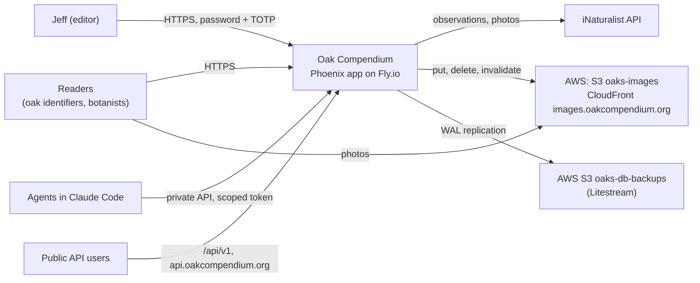
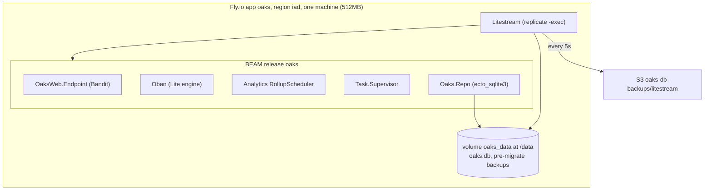
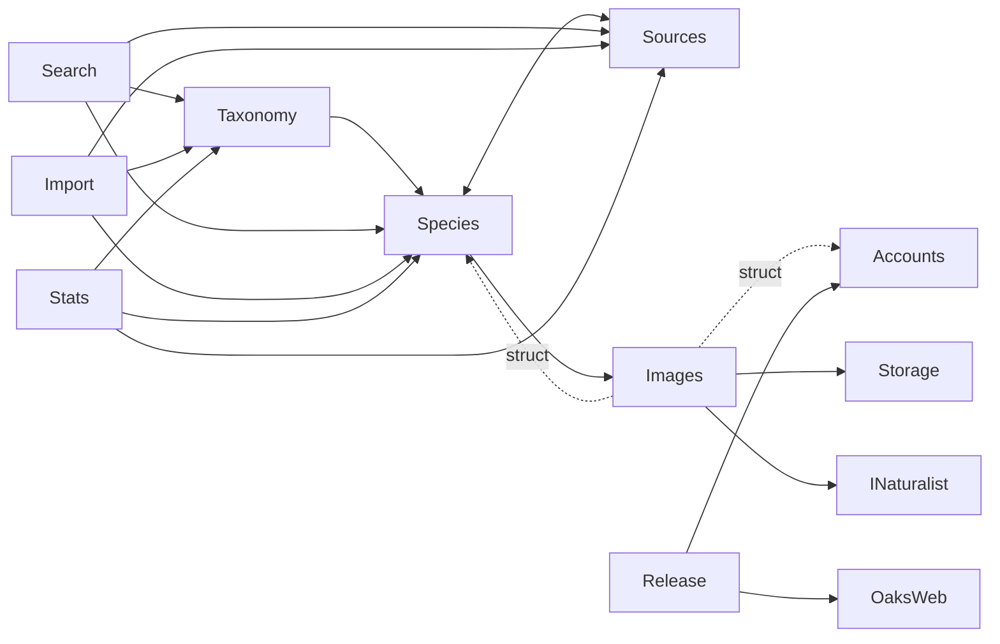

# Architecture

The current state of the Oak Compendium's architecture and design: what the system is made of and how its parts connect, as built. It describes only what exists. Planned changes live in the plans ([Facts expansion](../facts-expansion/README.md) and the others in `docs/`) and move into this doc as they land.

Visual design is governed by [DESIGN.md](../../DESIGN.md) and product truth by [PRODUCT.md](../../PRODUCT.md). This doc covers the design system's structure, not its look, and lists DESIGN.md's checkable rules in [rules.md](rules.md).

## How this doc is kept

- **[README.md](README.md)** (this file): the current state. It changes in the same commit as the code that changes the architecture.
- **[rules.md](rules.md)**: the architectural rules, each with its fitness function (the automated check that enforces it) or "manual", and its baseline of known violations.
- **[decisions.md](decisions.md)**: Jeff's decisions that shape the architecture, newest first. A new decision is added there, and this file and rules.md are updated to match, in the same commit.
- **[reviews.md](reviews.md)**: one entry per periodic review of the code against this doc. A review lists what it found; each violation becomes a fix, an accepted exception with a reason, or a new rule with a check. Jeff runs the review with heartwood's architecture reviewer: `MIX_ENV=test mix heartwood.architecture` writes the packet, he gives it to several models, and he combines their reports (kept in `.git/oaks-architecture/<run>/`) into one entry.

A rule's check starts at its baseline: today's count of violations is recorded, the check fails when the count grows, and the baseline is lowered as violations are fixed (the pattern `OaksWeb.Conformance` already uses, on heartwood's ratchet). A rule with no check is reviewed by hand until it has one.

## System context

- **Readers** use the public site; every GET page is public.
- **Jeff** (and any other user, all of whom are editors) logs in to edit in the site. There is no sign-up.
- **Agents** run outside the app and use the private API: they read, and submit bulk changes through the import endpoint (dry run first). The app makes no LLM calls.
- **The public JSON API** (`/api/v1`, also served on `api.oakcompendium.org`) is read-only and unauthenticated, documented by an OpenAPI spec at `/api/v1/docs`.

## Runtime

- **One machine, one database.** SQLite on the Fly volume (`/data/oaks.db`) is the system of record. The in-memory rate limiters and Oban's SQLite engine also assume a single machine; nothing in code prevents a second one.
- **Boot** (`docker-entrypoint.sh`): restore the database from Litestream if the volume has none; if migrations are pending, back the database up to `/data/backups` (three kept) and run `Oaks.Release.migrate/0`; then run the server under `litestream replicate -exec`. Migrations run here, not as a Fly release command, because a release command's volume changes don't persist.
- **Supervision tree** (`lib/oaks/application.ex`, one-for-one, in order): Telemetry, Repo, DNSCluster (unused: no query set), PubSub, Oban, Task.Supervisor, RateLimit (Hammer, ETS), Analytics RollupScheduler, Endpoint.
- **Background work.** Oban, Lite engine on the app's own database: one queue, `images` (2). Workers: `Images.ImportWorker` (download an iNat photo, store it and its variants, publish), `Images.CleanupWorker` (delete stored files, invalidate CloudFront, wait), `Images.RecoveryWorker` (cron at boot and every 15 minutes: re-enqueue unfinished work). Pruner 7 days, lifeline 10 minutes. Outside Oban: the hourly analytics rollup (a GenServer) and fire-and-forget page-view inserts on the Task.Supervisor.
- **PubSub.** `species_images:<id>` (photo changes, consumed by the species page for editors) and `users_sessions:<hash>` (disconnect on logout).

## Code structure

A Phoenix monolith: business logic in `lib/oaks/` as contexts, the web layer in `lib/oaks_web/`. The rule is that contexts own their tables and others call their public functions ([rules.md](rules.md), S1–S3); where today's code departs from it is listed there as the baseline.

### Contexts

| Context | Responsibility | Owns (tables) |
|---|---|---|
| `Oaks.Accounts` | Users, password and TOTP or recovery-code login, session and setup tokens, agent API tokens | `users`, `users_tokens`, `users_recovery_codes`, `api_tokens` |
| `Oaks.Species` (+ `Merge`, `References`) | Species, hybrids, the per-field source display rules, API maps, merging species, name-reference rewrites | `species` |
| `Oaks.Sources` | Sources and each species' per-source text | `sources`, `species_sources` |
| `Oaks.Taxonomy` | Higher taxa (subgenus to complex); renaming a taxon renames it on species | `taxa` |
| `Oaks.Articles` | Articles and guides | `articles` |
| `Oaks.Images` (+ workers) | Species photos from iNat: durable import, caption, order, delete, merge, cleanup | `images`, `image_import_attempts`, `image_cleanups` |
| `Oaks.Import` (+ `Body`, `Runner`, `Tables`) | The bulk import behind the private API: dry run, then apply in one transaction | `applied_imports`; `import_metadata` (`Import.Metadata`, left from the port and unused) |
| `Oaks.Analytics` (+ `Rollup`) | Anonymized page views and their daily rollups | `page_views`, `daily_stats`, `daily_page_stats`, `daily_referrer_stats`, `daily_error_stats` |
| `Oaks.Search` | Unified search across species, taxa and sources | none |
| `Oaks.Stats` | Counts for the About page and API | none |
| `Oaks.Storage.Images` (+ the `Adapter` behaviour, `S3`, `Local`, `Variants`; there is no `Oaks.Storage` module) | Photo storage behind an adapter: S3 and CloudFront in prod, local disk in dev, a Mox mock in tests; libvips variants | none |
| `Oaks.INaturalist` | iNat API client: observations, photos, licence mapping | none |
| `Oaks.Release` | Migrations at boot, setup links for users | none |

Shared utilities, usable by any context: `Oaks.Repo`, `ChangesetHelpers`, `JsonList` (JSON arrays in TEXT columns), `Licenses`, `Markdown` (MDEx, sanitized), `RateLimit`, `Version`.

### Dependencies as they are

From `mix xref graph`, folded into contexts (2026-11-26). Utilities and the web layer's edges are left out; OaksWeb depends on every context.

Species and Sources depend on each other (associations both ways, and each queries the other's table). Search and the import runner query and write other contexts' schemas through the Repo. Taxonomy reads species rows (species in a taxon, usage counts) and writes them on a rename. Stats uses only public functions. Nothing enforces the boundaries yet.

## Data

- **SQLite** through `ecto_sqlite3`; immediate transactions; `busy_timeout` 10s in prod; WAL and foreign keys on (adapter defaults). Queries must be SQLite-compatible (no `ilike`; LIKE with an ESCAPE clause).
- **Schema is defined only by migrations** in `priv/repo/migrations`; there is no `structure.sql`. Production applies pending migrations at boot. Data changes go through the app or the import endpoint, never hand-run SQL.
- **Links by name, not by key.** Species point at their taxa (`subgenus`, `section`, `subsection`, `complex`) and at other species (`parent1`, `parent2`, `hybrids`) by name; taxa point at their parent by name. None of these are foreign keys.
- **Foreign keys that matter:** `species_sources` cascade with their species and refuse a source's deletion; `images` restrict a species' deletion (photos are removed through `Oaks.Images` first, so their files are cleaned up); `image_cleanups` have no foreign keys on purpose, so a cleanup outlives its image and species.
- **JSON in TEXT columns:** species `hybrids`, `closely_related_to`, `subspecies_varieties`, `synonyms`, `external_links`; `species_sources.local_names`; `taxa.links`; `articles.tags`; arrays in `api_tokens` (scopes) and `image_cleanups` (file paths, and the ids of the import attempts the cleanup waits on).
- **Analytics** keeps raw `page_views` for 30 days after they are rolled up; the four daily tables have no Ecto schemas and are read and written through Ecto by table name; only the rollup's pending-day select and per-day delete are SQL.

## Web layer

- **Endpoint**: static files; request ID and telemetry; security headers on error responses; body parsers that answer API parse errors in JSON and hash the import body; session cookie (signed, encrypted, HttpOnly, SameSite Lax); the analytics plug; `ApiHost`, which limits `api.*` hosts to the API and its docs; the router.
- **Pipelines**: `:browser` (session, CSRF, CSP and security headers, current scope), `:api` (JSON, open CORS, OpenAPI spec), `:private_api` (JSON, agent token). `/health` sits outside every pipeline.
- **CSP**: `script-src 'self'` (no inline scripts or handlers), `style-src 'self' 'unsafe-inline'`, `img-src 'self' data: https:`. The API docs page has no CSP.
- **Authentication**: `OaksWeb.UserAuth` sets `@current_scope` on every request and LiveView (nil when logged out), with a remember-me cookie and a 14-day session token renewed after 7 days. Login is password then TOTP or a recovery code, rate limited in memory per IP and per account.
- **Authorization**: every LiveView, public and editor, is in one live session. Editor LiveViews check the scope in mount or handle_params and redirect when logged out, and every writing `handle_event` re-checks it. The `/settings` LiveView gates itself in mount; the `/users/settings/*` pages use plug-level `require_authenticated_user` and sudo mode. Agent tokens are checked by `OaksWeb.Plugs.ApiToken` (rate limited per token and per failing IP), and routes needing a scope use `require_api_scope/2`.
- **Pages**: public reading LiveViews (home, species list, species page, source comparison, taxonomy, articles, sources, search, about, privacy, Markdown help, analytics); editor LiveViews for species, merge, species source data, taxa, articles and sources, plus the species page's photo dialogs (LiveComponents); controllers for login, setup and settings; dev-only `/dev/log-in` and `/dev/components`, compiled only with `dev_routes`.
- **Public API** (`/api/v1`): GET only, OpenAPI specs declared on the controllers (`OpenApiSpex`), JSON built by the contexts' `to_map` functions. A synonym's species URL answers 301 to the accepted name.
- **Private API** (`/api/private/v1`): `GET /token` (who am I) and `POST /import` (needs `packages:submit`). An import is two calls: a dry run returns a report and a token bound to the body's hash, the agent token and the plan; the apply must send the same bytes with that token ([docs/import.md](../import.md)).

## Front end and design system

- **Rendering**: server-rendered LiveView. One JS bundle (`assets/js/app.js`, esbuild): LiveView, the topbar, and hooks (heartwood_ui's photo viewer, `SortablePhotos`, `PinCurrentTaxon`, `Tablist`, `TagInput`, `SearchSync`). No npm, no external scripts or fonts: fonts are self-hosted.
- **CSS**: Tailwind v4 (pinned binary). `assets/css/system/` holds the design system: `tokens.css` (the `@theme` tokens, kept by hand to match DESIGN.md's frontmatter), `fonts.css`, `base.css`, `components.css` (one `oc-` block per component, plus the photo viewer's `pv-` block) and `shell.css` (masthead and footer). `assets/css/app.css` holds the remaining page CSS, under a line budget that only shrinks.
- **Component library**: `CoreComponents` (buttons, inputs, header, edit menu, modal, page widths, …), `DesignComponents` (taxonomy band, scientific names, marks and stamps, source tabs, title-page parts, photos, ruled rows, notices, …), `FormComponents`, `AuthComponents` and `Layouts`, and heartwood_ui's photo viewer (through `<.species_photos>`). Every page is built from them; a page never builds its own version of something the library covers, and a missing component is added to the library first (CODING_STANDARDS.md, Components). `/dev/components` shows every component for review.
- **Shared with gallformers**: the photo viewer, `Heartwood.UI.PhotoViewer` from heartwood_ui: a function component with its hook and CSS as colocated assets, themed by custom properties, with no app-specific dependencies. Oaks themes it with `.oc-photos`.

## Delivery

- **Toolchain**: one Nix flake (Elixir 1.19, OTP 28, SQLite, libvips, Tailwind, OpenTofu) for dev and CI, loaded by direnv; the Dockerfile's builder and runtime images must match it, which heartwood's `check-toolchain` checks.
- **Checks**: `make done-checks` locally runs everything CI requires except the asset build: the test database rebuild, check-toolchain, `mix precommit`, `mix dialyzer`, `hex.audit`, `deps.audit` and Sobelow. `mix test`, in precommit, includes the guardrails (`Oaks.GuardrailsTest`): the UI rules (`OaksWeb.Conformance`, which replaced check-ui), copied code and retirements, each held to its baseline in `test/support/`. The guardrails' code, the git hooks and check-toolchain come from `heartwood_guardrails`, a dev and test dependency pinned by tag (`~/dev/heartwood`, shared with gallformers). CI has a Phoenix job (`mix deps.get`, then check-toolchain, the test database and `mix precommit`), an Assets job (the asset build), a Dialyzer job and, on PRs, an API Version Check (a change to the public API's controllers or spec must bump `API_VERSION`, which `Oaks.Version` reads at compile time). A security workflow runs the audits and Sobelow on every PR, on main and weekly. GitHub's `main-no-push` ruleset requires all five checks and blocks deletion and force pushes; Dependabot (alerts and security-update PRs) and CodeQL are on; every workflow's token is read-only. The full list, and what each enforces, is in [rules.md](rules.md).
- **Release**: PRs to main; Jeff merges on GitHub. A green CI run on main triggers `flyctl deploy --remote-only`, then `mix smoke_test` against oakcompendium.org; a manual deploy runs only from main, and a deploy run restores the dependency cache but never saves it. Per clone, `make hooks` installs heartwood's git hooks: the push guard blocks force pushes and pushes to main, and the commit gate blocks a commit until a reviewer with fresh context has recorded a passing reuse review of the staged tree (AGENTS.md, Before you commit).
- **Infrastructure**: AWS is described in OpenTofu (`infra/`, state in S3 `oaks-terraform-state`): the Litestream bucket and its IAM user; the images bucket (private, versioned, noncurrent versions expire after 30 days), its CloudFront distribution with Origin Access Control on `images.oakcompendium.org`, its certificate and the upload user. Fly (app, volume, machine, secrets) is managed with `fly.toml` and `fly secrets`; DNS is at Porkbun. The images upload key is kept outside tofu state. Details in [infra/README.md](../../infra/README.md).
- **Environments**: dev on port 4444 with the local storage adapter and a dev login; other branches via `make dev BRANCH=<name> PORT=<port>`; tests on a per-run copy of a template database, iNat and S3 stubbed with `Req.Test`, storage with Mox; production as above.

## Observability and data safety

- **Logs**: plain text with the request ID to stdout; Fly's log stream is the only sink. Passwords, tokens, API keys and codes are filtered from params, and requests for a setup link (`/users/setup/<token>`) aren't logged, since Phoenix logs paths unfiltered (`OaksWeb.Endpoint.log_level/1`).
- **Metrics**: Telemetry metrics are defined, but no reporter is attached and no dashboard is mounted.
- **Health**: `GET /health` runs `SELECT 1`. Nothing alerts on disk use, replication lag or errors.
- **Backups**: Litestream streams the database to S3 every 5 seconds (objects expire after 30 days); pre-migration copies on the volume; photos' deleted versions kept 30 days by S3 versioning. `make download-db` restores a local copy from the Litestream replica.
